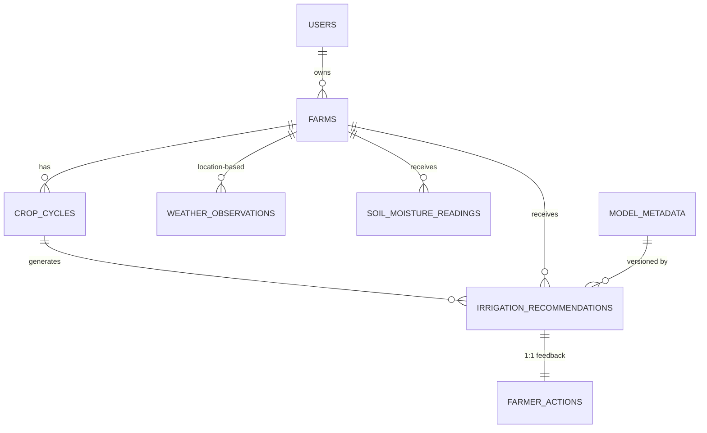

# JALRAKSHAK — MongoDB Schema and API Specification

**Version:** 1.0 (Phase 1 Deliverable)  
**Status:** PROPOSED — NEEDS STAKEHOLDER APPROVAL  
**Governed by:** AGENTS.md (technology stack, phase order, non-negotiable rules)  
**Roadmap:** JALRAKSHAK_Development_Plan.md  

---

## 1. MongoDB Collections Overview

| Collection | Purpose | Estimated Document Size | Retention |
|------------|---------|------------------------|-----------|
| `users` | Farmer accounts, authentication | ~500 bytes | Indefinite (until deletion request) |
| `farms` | Farm profiles (location, soil, irrigation) | ~1 KB | Indefinite |
| `crop_cycles` | Crop/variety, planting date, growth stage | ~800 bytes | 2 years after completion |
| `weather_observations` | Current + forecast weather per location | ~2 KB | 90 days (rolling) |
| `soil_moisture_readings` | Optional IoT/manual sensor readings | ~500 bytes | 1 year |
| `irrigation_recommendations` | Generated recommendations + input snapshots | ~3 KB | 2 years |
| `farmer_actions` | Farmer-recorded actions + feedback | ~500 bytes | 2 years |
| `model_metadata` | ML model versions, training info, metrics | ~1 KB | Indefinite |

---

## 2. Collection Schemas (Field-by-Field)

### 2.1 `users`

```json
{
  "_id": { "$oid": "653a1f2e4b8c9d0e1f2a3b4c" },
  "userId": "uuid-v4",
  "email": "farmer@example.com",
  "phone": "+91-9876543210",
  "passwordHash": "$2a$12$...",
  "fullName": "Ramesh Patil",
  "preferredLanguage": "en",
  "role": "FARMER",
  "isActive": true,
  "emailVerified": false,
  "phoneVerified": false,
  "lastLoginAt": { "$date": "2026-10-20T10:30:00Z" },
  "createdAt": { "$date": "2026-10-15T08:00:00Z" },
  "updatedAt": { "$date": "2026-10-20T10:30:00Z" }
}
```

| Field | BSON Type | Required | Validation | Index |
|-------|-----------|----------|------------|-------|
| `_id` | ObjectId | System | Auto | Primary |
| `userId` | String (UUID v4) | Yes | Unique, UUID v4 format | Unique |
| `email` | String | Yes* | Email format, unique | Unique (sparse) |
| `phone` | String | Yes* | E.164 format, unique | Unique (sparse) |
| `passwordHash` | String | Yes | BCrypt cost 12 | — |
| `fullName` | String | Yes | 1–100 chars | — |
| `preferredLanguage` | String | No | ISO 639-1 (en, hi, mr, ...) | — |
| `role` | String | Yes | Enum: `FARMER`, `ADMIN` | — |
| `isActive` | Boolean | Yes | Default true | — |
| `emailVerified` | Boolean | Yes | Default false | — |
| `phoneVerified` | Boolean | Yes | Default false | — |
| `lastLoginAt` | DateTime | No | ISO 8601 UTC | — |
| `createdAt` | DateTime | System | Auto | — |
| `updatedAt` | DateTime | System | Auto | — |

> *At least one of email or phone required.

**Indexes:**
```javascript
db.users.createIndex({ userId: 1 }, { unique: true });
db.users.createIndex({ email: 1 }, { unique: true, sparse: true });
db.users.createIndex({ phone: 1 }, { unique: true, sparse: true });
```

---

### 2.2 `farms`

```json
{
  "_id": { "$oid": "653a1f2e4b8c9d0e1f2a3b4d" },
  "farmId": "uuid-v4",
  "userId": "uuid-v4",
  "name": "East Field",
  "location": {
    "type": "Point",
    "coordinates": [78.9629, 20.9374]
  },
  "district": "Amravati",
  "state": "Maharashtra",
  "country": "India",
  "areaHectares": 2.5,
  "soilType": "BLACK_COTTON",
  "irrigationMethod": "DRIP",
  "waterSource": "BOREWELL",
  "soilMoistureSensorId": null,
  "isActive": true,
  "createdAt": { "$date": "2026-10-15T08:15:00Z" },
  "updatedAt": { "$date": "2026-10-15T08:15:00Z" }
}
```

| Field | BSON Type | Required | Validation | Index |
|-------|-----------|----------|------------|-------|
| `_id` | ObjectId | System | Auto | Primary |
| `farmId` | String (UUID v4) | Yes | Unique | Unique |
| `userId` | String (UUID v4) | Yes | FK → users.userId | — |
| `name` | String | Yes | 1–100 chars | — |
| `location` | GeoJSON Point | Yes | Valid [lon, lat], 2dsphere | 2dsphere |
| `district` | String | No | Derived from coordinates | — |
| `state` | String | No | Derived from coordinates | — |
| `country` | String | No | Default "India" | — |
| `areaHectares` | Double | Yes | >0, ≤1000 | — |
| `soilType` | String | Yes | Enum (see below) | — |
| `irrigationMethod` | String | Yes | Enum: FLOOD, SPRINKLER, DRIP, RAINFED, OTHER | — |
| `waterSource` | String | Yes | Enum: CANAL, BOREWELL, TANK, RIVER, MUNICIPAL, MIXED | — |
| `soilMoistureSensorId` | String | No | FK to sensor registry (future) | — |
| `isActive` | Boolean | Yes | Default true | — |
| `createdAt` | DateTime | System | Auto | — |
| `updatedAt` | DateTime | System | Auto | — |

**SoilType Enum:** `LOAM`, `CLAY`, `SANDY_LOAM`, `SILT`, `CLAY_LOAM`, `BLACK_COTTON`, `RED_LATERITIC`, `ALLUVIAL`, `OTHER`

**Indexes:**
```javascript
db.farms.createIndex({ farmId: 1 }, { unique: true });
db.farms.createIndex({ userId: 1 });
db.farms.createIndex({ location: "2dsphere" });
db.farms.createIndex({ userId: 1, isActive: 1 });
```

---

### 2.3 `crop_cycles`

```json
{
  "_id": { "$oid": "653a1f2e4b8c9d0e1f2a3b4e" },
  "cropCycleId": "uuid-v4",
  "farmId": "uuid-v4",
  "crop": "RICE",
  "variety": "Swarna",
  "plantingDate": { "$date": "2026-06-15T00:00:00Z" },
  "expectedHarvestDate": { "$date": "2026-10-15T00:00:00Z" },
  "growthStage": "PANICLE_INITIATION",
  "status": "ACTIVE",
  "cropCalendar": {
    "SEEDLING": { "startDay": 0, "endDay": 20 },
    "TILLERING": { "startDay": 21, "endDay": 50 },
    "PANICLE_INITIATION": { "startDay": 51, "endDay": 75 },
    "FLOWERING": { "startDay": 76, "endDay": 95 },
    "GRAIN_FILLING": { "startDay": 96, "endDay": 115 },
    "MATURITY": { "startDay": 116, "endDay": 130 }
  },
  "createdAt": { "$date": "2026-06-15T08:00:00Z" },
  "updatedAt": { "$date": "2026-10-20T06:00:00Z" }
}
```

| Field | BSON Type | Required | Validation | Index |
|-------|-----------|----------|------------|-------|
| `_id` | ObjectId | System | Auto | Primary |
| `cropCycleId` | String (UUID v4) | Yes | Unique | Unique |
| `farmId` | String (UUID v4) | Yes | FK → farms.farmId | — |
| `crop` | String | Yes | Enum: RICE, WHEAT, COTTON, MAIZE, SUGARCANE, SOYBEAN, PIGEON_PEA, CHICKPEA, OTHER | — |
| `variety` | String | No | 1–50 chars | — |
| `plantingDate` | DateTime | Yes | Not future | — |
| `expectedHarvestDate` | DateTime | No | > plantingDate | — |
| `growthStage` | String | Derived | Enum (see below) | — |
| `status` | String | Yes | Enum: ACTIVE, COMPLETED, ABANDONED | — |
| `cropCalendar` | Document | No | Crop-specific stage days | — |
| `createdAt` | DateTime | System | Auto | — |
| `updatedAt` | DateTime | System | Auto | — |

**GrowthStage Enum:** `SEEDLING`, `TILLERING`, `PANICLE_INITIATION`, `FLOWERING`, `GRAIN_FILLING`, `MATURITY`, `HARVESTED`

**Indexes:**
```javascript
db.crop_cycles.createIndex({ cropCycleId: 1 }, { unique: true });
db.crop_cycles.createIndex({ farmId: 1, status: 1 });
db.crop_cycles.createIndex({ farmId: 1, plantingDate: -1 });
```

---

### 2.4 `weather_observations`

```json
{
  "_id": { "$oid": "653a1f2e4b8c9d0e1f2a3b4f" },
  "observationId": "uuid-v4",
  "source": "OPENWEATHER",
  "location": {
    "type": "Point",
    "coordinates": [78.9629, 20.9374]
  },
  "observationType": "CURRENT",
  "observedAt": { "$date": "2026-10-21T06:00:00Z" },
  "data": {
    "temperatureC": 28.5,
    "humidityPct": 72,
    "windSpeedMs": 3.2,
    "windDirectionDeg": 240,
    "rainfallMm": 0,
    "pressureHp": 1012,
    "et0Mm": 4.8,
    "solarRadiationMjM2": 18.5
  },
  "forecast": [
    {
      "validAt": { "$date": "2026-10-21T09:00:00Z" },
      "temperatureC": 30.1,
      "humidityPct": 68,
      "rainfallMm": 0,
      "et0Mm": 5.2
    },
    {
      "validAt": { "$date": "2026-10-21T12:00:00Z" },
      "temperatureC": 32.4,
      "humidityPct": 60,
      "rainfallMm": 0,
      "et0Mm": 6.1
    }
  ],
  "rawProviderResponse": { ... },
  "createdAt": { "$date": "2026-10-21T06:05:00Z" }
}
```

| Field | BSON Type | Required | Validation | Index |
|-------|-----------|----------|------------|-------|
| `_id` | ObjectId | System | Auto | Primary |
| `observationId` | String (UUID v4) | Yes | Unique | Unique |
| `source` | String | Yes | Enum: IMD, OPENWEATHER, CUSTOM, MANUAL | — |
| `location` | GeoJSON Point | Yes | Valid [lon, lat] | 2dsphere |
| `observationType` | String | Yes | Enum: CURRENT, FORECAST, HISTORICAL | — |
| `observedAt` | DateTime | Yes | Timestamp of observation | — |
| `data` | Document | Yes | See fields below | — |
| `data.temperatureC` | Double | Yes | -40 to 60 | — |
| `data.humidityPct` | Int32 | Yes | 0–100 | — |
| `data.windSpeedMs` | Double | Yes | ≥0 | — |
| `data.windDirectionDeg` | Int32 | No | 0–360 | — |
| `data.rainfallMm` | Double | Yes | ≥0 | — |
| `data.pressureHp` | Double | No | 800–1100 | — |
| `data.et0Mm` | Double | No | ≥0 (reference evapotranspiration) | — |
| `data.solarRadiationMjM2` | Double | No | ≥0 | — |
| `forecast` | Array | No | Max 72 entries (hourly) | — |
| `forecast[].validAt` | DateTime | Yes | Future timestamp | — |
| `forecast[].temperatureC` | Double | Yes | -40 to 60 | — |
| `forecast[].humidityPct` | Int32 | Yes | 0–100 | — |
| `forecast[].rainfallMm` | Double | Yes | ≥0 | — |
| `forecast[].et0Mm` | Double | No | ≥0 | — |
| `rawProviderResponse` | Document | No | Original API response (debug) | — |
| `createdAt` | DateTime | System | Auto | — |

**Indexes:**
```javascript
db.weather_observations.createIndex({ observationId: 1 }, { unique: true });
db.weather_observations.createIndex({ location: "2dsphere", observedAt: -1 });
db.weather_observations.createIndex({ source: 1, observationType: 1, observedAt: -1 });
// TTL index for auto-cleanup (90 days)
db.weather_observations.createIndex({ createdAt: 1 }, { expireAfterSeconds: 7776000 });
```

---

### 2.5 `soil_moisture_readings`

```json
{
  "_id": { "$oid": "653a1f2e4b8c9d0e1f2a3b50" },
  "readingId": "uuid-v4",
  "farmId": "uuid-v4",
  "sensorId": "sensor-001",
  "depthCm": 30,
  "moisturePct": 22.5,
  "temperatureC": 26.3,
  "ecDsM": 0.8,
  "batteryPct": 85,
  "signalStrengthDbm": -72,
  "quality": "GOOD",
  "recordedAt": { "$date": "2026-10-21T05:30:00Z" },
  "ingestedAt": { "$date": "2026-10-21T05:31:00Z" },
  "createdAt": { "$date": "2026-10-21T05:31:00Z" }
}
```

| Field | BSON Type | Required | Validation | Index |
|-------|-----------|----------|------------|-------|
| `_id` | ObjectId | System | Auto | Primary |
| `readingId` | String (UUID v4) | Yes | Unique | Unique |
| `farmId` | String (UUID v4) | Yes | FK → farms.farmId | — |
| `sensorId` | String | Yes | Registered to farm | — |
| `depthCm` | Int32 | Yes | Enum: 15, 30, 60, 90 | — |
| `moisturePct` | Double | Yes | 0–100 | — |
| `temperatureC` | Double | No | -10 to 60 | — |
| `ecDsM` | Double | No | ≥0 (electrical conductivity) | — |
| `batteryPct` | Int32 | No | 0–100 | — |
| `signalStrengthDbm` | Int32 | No | -120 to 0 | — |
| `quality` | String | Yes | Enum: GOOD, SUSPECT, BAD, CALIBRATING | — |
| `recordedAt` | DateTime | Yes | Sensor timestamp | — |
| `ingestedAt` | DateTime | System | Server receive time | — |
| `createdAt` | DateTime | System | Auto | — |

**Indexes:**
```javascript
db.soil_moisture_readings.createIndex({ readingId: 1 }, { unique: true });
db.soil_moisture_readings.createIndex({ farmId: 1, recordedAt: -1 });
db.soil_moisture_readings.createIndex({ sensorId: 1, recordedAt: -1 });
```

---

### 2.6 `irrigation_recommendations`

```json
{
  "_id": { "$oid": "653a1f2e4b8c9d0e1f2a3b51" },
  "recommendationId": "uuid-v4",
  "farmId": "uuid-v4",
  "cropCycleId": "uuid-v4",
  "action": "IRRIGATE",
  "estimatedWaterQuantityMm": 25.5,
  "estimatedWaterVolumeLitres": 255000,
  "confidence": "HIGH",
  "reasons": [
    "Soil moisture at 30cm depth is 18% (threshold: 22% for PANICLE_INITIATION)",
    "No significant rainfall forecast in next 72 hours (total: 0mm)",
    "Crop at PANICLE_INITIATION — critical water-sensitive stage"
  ],
  "warnings": [
    "Weather data is 18 hours old",
    "No soil moisture sensor reading available (using water balance estimate)"
  ],
  "dataFreshness": {
    "weatherDataAgeHours": 18,
    "soilMoistureAgeHours": null,
    "forecastHorizonHours": 72
  },
  "modelVersion": "v1.0.0-baseline",
  "modelPrediction": {
    "irrigationNeedMm": 28.3,
    "predictionConfidence": 0.72,
    "featuresUsed": ["cropStage", "soilDeficit", "et0", "rainfall72h"]
  },
  "decisionRulesApplied": [
    "RULE-WB-01: Water balance deficit > 20mm → IRRIGATE",
    "RULE-FC-03: Forecast rainfall < 5mm in 72h → no deferral",
    "RULE-STAGE-02: PANICLE_INITIATION stage → lower threshold"
  ],
  "inputSnapshot": {
    "farm": { "farmId": "...", "soilType": "BLACK_COTTON", "irrigationMethod": "DRIP", "areaHectares": 2.5 },
    "cropCycle": { "cropCycleId": "...", "crop": "RICE", "growthStage": "PANICLE_INITIATION", "daysAfterPlanting": 65 },
    "weather": { "observationId": "...", "source": "OPENWEATHER", "currentRainfallMm": 0, "forecastRainfall72hMm": 0, "et0Mm": 5.2 },
    "soilMoisture": { "readingId": null, "moisturePct": null, "depthCm": null, "ageHours": null }
  },
  "generatedAt": { "$date": "2026-10-21T06:30:00Z" },
  "validUntil": { "$date": "2026-10-21T18:30:00Z" },
  "createdAt": { "$date": "2026-10-21T06:30:00Z" }
}
```

| Field | BSON Type | Required | Validation | Index |
|-------|-----------|----------|------------|-------|
| `_id` | ObjectId | System | Auto | Primary |
| `recommendationId` | String (UUID v4) | Yes | Unique | Unique |
| `farmId` | String (UUID v4) | Yes | FK → farms.farmId | — |
| `cropCycleId` | String (UUID v4) | Yes | FK → crop_cycles.cropCycleId | — |
| `action` | String | Yes | Enum: IRRIGATE, WAIT, PARTIAL_IRRIGATION, INSUFFICIENT_DATA | — |
| `estimatedWaterQuantityMm` | Double | Conditional | ≥0; only if action ≠ WAIT/INSUFFICIENT_DATA | — |
| `estimatedWaterVolumeLitres` | Double | Conditional | = quantityMm × areaHectares × 10000 | — |
| `confidence` | String | Yes | Enum: HIGH, MEDIUM, LOW | — |
| `reasons` | Array<String> | Yes | Min 1; human-readable | — |
| `warnings` | Array<String> | Yes | Can be empty | — |
| `dataFreshness` | Document | Yes | See subfields | — |
| `dataFreshness.weatherDataAgeHours` | Double | Yes | ≥0 | — |
| `dataFreshness.soilMoistureAgeHours` | Double | No | ≥0 or null | — |
| `dataFreshness.forecastHorizonHours` | Int32 | Yes | Default 72 | — |
| `modelVersion` | String | Yes | Semver + tag | — |
| `modelPrediction` | Document | Conditional | Required if ML available | — |
| `modelPrediction.irrigationNeedMm` | Double | Yes | ≥0 | — |
| `modelPrediction.predictionConfidence` | Double | Yes | 0–1 | — |
| `modelPrediction.featuresUsed` | Array<String> | Yes | Feature names | — |
| `decisionRulesApplied` | Array<String> | Yes | Rule IDs triggered | — |
| `inputSnapshot` | Document | Yes | Full input snapshot for audit | — |
| `generatedAt` | DateTime | Yes | Recommendation timestamp | — |
| `validUntil` | DateTime | Yes | Typically 12h | — |
| `createdAt` | DateTime | System | Auto | — |

**Indexes:**
```javascript
db.irrigation_recommendations.createIndex({ recommendationId: 1 }, { unique: true });
db.irrigation_recommendations.createIndex({ farmId: 1, generatedAt: -1 });
db.irrigation_recommendations.createIndex({ cropCycleId: 1, generatedAt: -1 });
db.irrigation_recommendations.createIndex({ action: 1, generatedAt: -1 });
```

---

### 2.7 `farmer_actions`

```json
{
  "_id": { "$oid": "653a1f2e4b8c9d0e1f2a3b52" },
  "actionId": "uuid-v4",
  "recommendationId": "uuid-v4",
  "farmId": "uuid-v4",
  "actionTaken": "IRRIGATED",
  "actionTimestamp": { "$date": "2026-10-21T07:00:00Z" },
  "waterAppliedMm": 25,
  "waterAppliedLitres": 250000,
  "durationMinutes": 120,
  "notes": "Started at 7am, completed by 9am",
  "outcomeObserved": null,
  "outcomeTimestamp": null,
  "feedback": "Recommendation matched my assessment",
  "createdAt": { "$date": "2026-10-21T07:05:00Z" }
}
```

| Field | BSON Type | Required | Validation | Index |
|-------|-----------|----------|------------|-------|
| `_id` | ObjectId | System | Auto | Primary |
| `actionId` | String (UUID v4) | Yes | Unique | Unique |
| `recommendationId` | String (UUID v4) | Yes | FK → irrigation_recommendations.recommendationId | — |
| `farmId` | String (UUID v4) | Yes | FK → farms.farmId | — |
| `actionTaken` | String | Yes | Enum: IRRIGATED, WAITED, PARTIAL_IRRIGATED, OTHER | — |
| `actionTimestamp` | DateTime | Yes | When action performed | — |
| `waterAppliedMm` | Double | Conditional | ≥0; if IRRIGATED/PARTIAL | — |
| `waterAppliedLitres` | Double | Conditional | = mm × area × 10000 | — |
| `durationMinutes` | Int32 | No | ≥0 | — |
| `notes` | String | No | ≤500 chars | — |
| `outcomeObserved` | String | No | e.g., "Crop improved", "Waterlogged" | — |
| `outcomeTimestamp` | DateTime | No | When outcome observed | — |
| `feedback` | String | No | ≤500 chars | — |
| `createdAt` | DateTime | System | Auto | — |

**Indexes:**
```javascript
db.farmer_actions.createIndex({ actionId: 1 }, { unique: true });
db.farmer_actions.createIndex({ recommendationId: 1 }, { unique: true });
db.farmer_actions.createIndex({ farmId: 1, actionTimestamp: -1 });
```

---

### 2.8 `model_metadata`

```json
{
  "_id": { "$oid": "653a1f2e4b8c9d0e1f2a3b53" },
  "modelId": "uuid-v4",
  "version": "v1.0.0-baseline",
  "algorithm": "XGBoost",
  "trainingDataset": {
    "source": "ICAR-CRIDA + IMD + Farmer Survey 2020-2024",
    "samples": 12500,
    "features": 18,
    "dateRange": "2020-06-01 to 2024-09-30",
    "crops": ["RICE", "WHEAT"],
    "regions": ["Maharashtra", "Punjab"]
  },
  "targetVariable": "irrigation_need_mm",
  "metrics": {
    "mae": 4.2,
    "rmse": 6.8,
    "r2": 0.71,
    "within_5mm_pct": 0.68
  },
  "featureImportance": [
    { "feature": "soil_moisture_deficit", "importance": 0.32 },
    { "feature": "crop_stage_encoded", "importance": 0.24 },
    { "feature": "et0_72h_avg", "importance": 0.18 },
    { "feature": "rainfall_72h_sum", "importance": 0.15 },
    { "feature": "soil_type_encoded", "importance": 0.11 }
  ],
  "preprocessingPipeline": "StandardScaler + OneHotEncoder (crop, soil, stage)",
  "trainingDate": { "$date": "2026-10-01T00:00:00Z" },
  "deployedAt": { "$date": "2026-10-15T00:00:00Z" },
  "isActive": true,
  "notes": "Baseline model; no soil moisture sensor data in training",
  "createdAt": { "$date": "2026-10-15T00:00:00Z" }
}
```

| Field | BSON Type | Required | Validation | Index |
|-------|-----------|----------|------------|-------|
| `_id` | ObjectId | System | Auto | Primary |
| `modelId` | String (UUID v4) | Yes | Unique | Unique |
| `version` | String | Yes | Semver + tag | — |
| `algorithm` | String | Yes | e.g., XGBoost, RandomForest, LinearRegression | — |
| `trainingDataset` | Document | Yes | See subfields | — |
| `trainingDataset.source` | String | Yes | Data provenance | — |
| `trainingDataset.samples` | Int32 | Yes | >0 | — |
| `trainingDataset.features` | Int32 | Yes | >0 | — |
| `trainingDataset.dateRange` | String | Yes | ISO date range | — |
| `trainingDataset.crops` | Array<String> | Yes | Supported crops | — |
| `trainingDataset.regions` | Array<String> | Yes | Supported regions | — |
| `targetVariable` | String | Yes | e.g., irrigation_need_mm | — |
| `metrics` | Document | Yes | MAE, RMSE, R², custom | — |
| `featureImportance` | Array<Document> | No | Top features | — |
| `preprocessingPipeline` | String | Yes | Description of steps | — |
| `trainingDate` | DateTime | Yes | When model trained | — |
| `deployedAt` | DateTime | No | When deployed to ML service | — |
| `isActive` | Boolean | Yes | Current production model | — |
| `notes` | String | No | Limitations, caveats | — |
| `createdAt` | DateTime | System | Auto | — |

**Indexes:**
```javascript
db.model_metadata.createIndex({ modelId: 1 }, { unique: true });
db.model_metadata.createIndex({ version: 1 }, { unique: true });
db.model_metadata.createIndex({ isActive: 1, deployedAt: -1 });
```

---

## 3. Relationships and References



### Reference Rules
- **All cross-collection references use UUID v4 strings** (not ObjectId) — portable, no MongoDB dependency in ML service.
- **No embedded documents for entities with independent lifecycle** (User, Farm, CropCycle).
- **Embedded snapshots** in `irrigation_recommendations.inputSnapshot` for audit trail (immutable at generation time).
- **Cascade delete:** Deleting Farm → delete CropCycles, Recommendations, Actions, SoilReadings. User deletion → anonymize (GDPR).

---

## 4. Data Validation and Migration Strategy

### 4.1 Schema Validation (MongoDB Native)

```javascript
// Example: farms collection validator
db.createCollection("farms", {
  validator: {
    $jsonSchema: {
      bsonType: "object",
      required: ["farmId", "userId", "name", "location", "areaHectares", "soilType", "irrigationMethod", "waterSource"],
      properties: {
        farmId: { bsonType: "string", pattern: "^[0-9a-f-]{36}$" },
        userId: { bsonType: "string", pattern: "^[0-9a-f-]{36}$" },
        name: { bsonType: "string", minLength: 1, maxLength: 100 },
        location: {
          bsonType: "object",
          required: ["type", "coordinates"],
          properties: {
            type: { enum: ["Point"] },
            coordinates: { bsonType: "array", minItems: 2, maxItems: 2, items: { bsonType: "double" } }
          }
        },
        areaHectares: { bsonType: "double", minimum: 0.001, maximum: 1000 },
        soilType: { enum: ["LOAM", "CLAY", "SANDY_LOAM", "SILT", "CLAY_LOAM", "BLACK_COTTON", "RED_LATERITIC", "ALLUVIAL", "OTHER"] },
        irrigationMethod: { enum: ["FLOOD", "SPRINKLER", "DRIP", "RAINFED", "OTHER"] },
        waterSource: { enum: ["CANAL", "BOREWELL", "TANK", "RIVER", "MUNICIPAL", "MIXED"] }
      }
    }
  },
  validationLevel: "moderate",
  validationAction: "error"
});
```

### 4.2 Application-Level Validation (Spring Boot)
- **Bean Validation (JSR-380)** on all DTOs: `@NotNull`, `@Size`, `@Min`, `@Max`, `@Pattern`, custom `@ValidEnum`.
- **Cross-field validation:** e.g., `expectedHarvestDate > plantingDate`, unique active crop cycle per farm.
- **Custom validators:** Coordinate bounds, soil type per region, crop calendar alignment.

### 4.3 Migration / Versioning Strategy

| Approach | Tool | When |
|----------|------|------|
| **Schema evolution** | MongoDB native (flexible schema) | Additive changes (new optional fields) |
| **Data migrations** | Mongock (Java) / custom scripts | Breaking changes, backfills, enum additions |
| **Version tracking** | `schema_version` collection | Each migration records version, description, checksum |
| **Rollback** | Down migrations (where possible) | Test in staging first |

**Migration Example (Mongock):**
```java
@ChangeLog(order = "1")
public class FarmSchemaMigration {
    @ChangeSet(order = "1", id = "add-soil-moisture-sensor-id", author = "jalrakshak")
    public void addSensorId(MongoDatabase db) {
        db.getCollection("farms").updateMany(
            new Document(),
            new Document("$set", new Document("soilMoistureSensorId", null))
        );
    }
}
```

---

## 5. API Specification (Spring Boot REST API)

### 5.1 Conventions

| Convention | Standard |
|------------|----------|
| Base Path | `/api/v1` |
| Auth | `Authorization: Bearer <JWT>` |
| Content-Type | `application/json` |
| Date Format | ISO 8601 UTC (`yyyy-MM-dd'T'HH:mm:ss.SSS'Z'`) |
| UUID Format | RFC 4122 v4 (lowercase with hyphens) |
| Pagination | `page` (0-based), `size` (default 20, max 100) |
| Sorting | `sort=field,asc|desc` (multiple allowed) |
| Filtering | `filter[field]=value` (exact), `filter[field][gte]=value` (range) |
| Error Format | RFC 7807 Problem Details |

### 5.2 Error Response Format

```json
{
  "type": "https://jalrakshak.example.com/errors/validation-failed",
  "title": "Validation Failed",
  "status": 400,
  "detail": "One or more fields failed validation",
  "instance": "/api/v1/farms",
  "errors": [
    { "field": "areaHectares", "code": "Min", "message": "must be > 0", "rejectedValue": 0 },
    { "field": "soilType", "code": "NotNull", "message": "must not be null", "rejectedValue": null }
  ],
  "timestamp": "2026-10-21T06:30:00Z",
  "traceId": "a1b2c3d4e5f6"
}
```

### 5.3 Authentication Endpoints

| Method | Path | Auth | Purpose |
|--------|------|------|---------|
| POST | `/api/v1/auth/register` | Public | Register new farmer |
| POST | `/api/v1/auth/login` | Public | Obtain access + refresh tokens |
| POST | `/api/v1/auth/refresh` | Refresh Token | Rotate access token |
| POST | `/api/v1/auth/logout` | Access Token | Revoke refresh token |
| GET | `/api/v1/auth/me` | Access Token | Current user profile |

#### `POST /api/v1/auth/register`

**Request:**
```json
{
  "email": "farmer@example.com",
  "phone": "+91-9876543210",
  "password": "SecurePass123!",
  "fullName": "Ramesh Patil",
  "preferredLanguage": "en"
}
```

**Response (201):**
```json
{
  "userId": "uuid-v4",
  "email": "farmer@example.com",
  "phone": "+91-9876543210",
  "fullName": "Ramesh Patil",
  "preferredLanguage": "en",
  "role": "FARMER",
  "createdAt": "2026-10-21T06:30:00Z"
}
```

#### `POST /api/v1/auth/login`

**Request:**
```json
{
  "identifier": "farmer@example.com",
  "password": "SecurePass123!"
}
```

**Response (200):**
```json
{
  "accessToken": "eyJhbGciOiJSUzI1NiIs...",
  "refreshToken": "dGhpcyBpcyBhIHJlZnJl...",
  "tokenType": "Bearer",
  "expiresIn": 900,
  "user": {
    "userId": "uuid-v4",
    "email": "farmer@example.com",
    "fullName": "Ramesh Patil",
    "preferredLanguage": "en",
    "role": "FARMER"
  }
}
```

---

### 5.4 Farm Endpoints

| Method | Path | Auth | Purpose |
|--------|------|------|---------|
| POST | `/api/v1/farms` | Access Token | Create farm profile |
| GET | `/api/v1/farms` | Access Token | List own farms (paginated) |
| GET | `/api/v1/farms/{farmId}` | Access Token | Get farm details |
| PUT | `/api/v1/farms/{farmId}` | Access Token | Update farm |
| DELETE | `/api/v1/farms/{farmId}` | Access Token | Deactivate farm |

#### `POST /api/v1/farms`

**Request:**
```json
{
  "name": "East Field",
  "location": { "type": "Point", "coordinates": [78.9629, 20.9374] },
  "areaHectares": 2.5,
  "soilType": "BLACK_COTTON",
  "irrigationMethod": "DRIP",
  "waterSource": "BOREWELL"
}
```

**Response (201):**
```json
{
  "farmId": "uuid-v4",
  "name": "East Field",
  "location": { "type": "Point", "coordinates": [78.9629, 20.9374] },
  "district": "Amravati",
  "state": "Maharashtra",
  "country": "India",
  "areaHectares": 2.5,
  "soilType": "BLACK_COTTON",
  "irrigationMethod": "DRIP",
  "waterSource": "BOREWELL",
  "isActive": true,
  "createdAt": "2026-10-21T06:30:00Z",
  "updatedAt": "2026-10-21T06:30:00Z"
}
```

---

### 5.5 Crop Cycle Endpoints

| Method | Path | Auth | Purpose |
|--------|------|------|---------|
| POST | `/api/v1/farms/{farmId}/crop-cycles` | Access Token | Start new crop cycle |
| GET | `/api/v1/farms/{farmId}/crop-cycles` | Access Token | List crop cycles (paginated) |
| GET | `/api/v1/farms/{farmId}/crop-cycles/active` | Access Token | Get active crop cycle |
| PUT | `/api/v1/crop-cycles/{cropCycleId}` | Access Token | Update crop cycle |
| POST | `/api/v1/crop-cycles/{cropCycleId}/complete` | Access Token | Mark cycle complete |

#### `POST /api/v1/farms/{farmId}/crop-cycles`

**Request:**
```json
{
  "crop": "RICE",
  "variety": "Swarna",
  "plantingDate": "2026-06-15",
  "expectedHarvestDate": "2026-10-15"
}
```

**Response (201):**
```json
{
  "cropCycleId": "uuid-v4",
  "farmId": "uuid-v4",
  "crop": "RICE",
  "variety": "Swarna",
  "plantingDate": "2026-06-15T00:00:00Z",
  "expectedHarvestDate": "2026-10-15T00:00:00Z",
  "growthStage": "SEEDLING",
  "status": "ACTIVE",
  "createdAt": "2026-10-21T06:30:00Z",
  "updatedAt": "2026-10-21T06:30:00Z"
}
```

---

### 5.6 Recommendation Endpoints

| Method | Path | Auth | Purpose |
|--------|------|------|---------|
| GET | `/api/v1/farms/{farmId}/recommendations/latest` | Access Token | Get latest recommendation |
| GET | `/api/v1/farms/{farmId}/recommendations` | Access Token | List recommendations (paginated) |
| GET | `/api/v1/recommendations/{recommendationId}` | Access Token | Get recommendation by ID |

#### `GET /api/v1/farms/{farmId}/recommendations/latest`

**Response (200):**
```json
{
  "recommendationId": "uuid-v4",
  "farmId": "uuid-v4",
  "cropCycleId": "uuid-v4",
  "action": "IRRIGATE",
  "estimatedWaterQuantityMm": 25.5,
  "estimatedWaterVolumeLitres": 255000,
  "confidence": "HIGH",
  "reasons": [
    "Soil moisture at 30cm depth is 18% (threshold: 22% for PANICLE_INITIATION)",
    "No significant rainfall forecast in next 72 hours (total: 0mm)",
    "Crop at PANICLE_INITIATION — critical water-sensitive stage"
  ],
  "warnings": [
    "Weather data is 18 hours old",
    "No soil moisture sensor reading available"
  ],
  "dataFreshness": {
    "weatherDataAgeHours": 18,
    "soilMoistureAgeHours": null,
    "forecastHorizonHours": 72
  },
  "modelVersion": "v1.0.0-baseline",
  "modelPrediction": {
    "irrigationNeedMm": 28.3,
    "predictionConfidence": 0.72,
    "featuresUsed": ["cropStage", "soilDeficit", "et0", "rainfall72h"]
  },
  "decisionRulesApplied": [
    "RULE-WB-01: Water balance deficit > 20mm → IRRIGATE",
    "RULE-FC-03: Forecast rainfall < 5mm in 72h → no deferral",
    "RULE-STAGE-02: PANICLE_INITIATION stage → lower threshold"
  ],
  "generatedAt": "2026-10-21T06:30:00Z",
  "validUntil": "2026-10-21T18:30:00Z"
}
```

**Response (200 — INSUFFICIENT_DATA):**
```json
{
  "recommendationId": "uuid-v4",
  "farmId": "uuid-v4",
  "cropCycleId": "uuid-v4",
  "action": "INSUFFICIENT_DATA",
  "estimatedWaterQuantityMm": null,
  "estimatedWaterVolumeLitres": null,
  "confidence": "LOW",
  "reasons": [],
  "warnings": [
    "No active crop cycle for this farm",
    "Weather data is 30 hours old (max allowed: 24h)"
  ],
  "dataFreshness": {
    "weatherDataAgeHours": 30,
    "soilMoistureAgeHours": null,
    "forecastHorizonHours": 72
  },
  "modelVersion": "v1.0.0-baseline",
  "modelPrediction": null,
  "decisionRulesApplied": [
    "RULE-DATA-01: No active crop cycle → INSUFFICIENT_DATA",
    "RULE-DATA-02: Weather data > 24h old → INSUFFICIENT_DATA"
  ],
  "generatedAt": "2026-10-21T06:30:00Z",
  "validUntil": "2026-10-21T18:30:00Z"
}
```

---

### 5.7 Farmer Action / Feedback Endpoints

| Method | Path | Auth | Purpose |
|--------|------|------|---------|
| POST | `/api/v1/recommendations/{recommendationId}/feedback` | Access Token | Record action taken |
| GET | `/api/v1/farms/{farmId}/actions` | Access Token | List farmer actions (paginated) |

#### `POST /api/v1/recommendations/{recommendationId}/feedback`

**Request:**
```json
{
  "actionTaken": "IRRIGATED",
  "actionTimestamp": "2026-10-21T07:00:00Z",
  "waterAppliedMm": 25,
  "durationMinutes": 120,
  "notes": "Started at 7am, completed by 9am",
  "feedback": "Recommendation matched my assessment"
}
```

**Response (201):**
```json
{
  "actionId": "uuid-v4",
  "recommendationId": "uuid-v4",
  "farmId": "uuid-v4",
  "actionTaken": "IRRIGATED",
  "actionTimestamp": "2026-10-21T07:00:00Z",
  "waterAppliedMm": 25,
  "waterAppliedLitres": 250000,
  "durationMinutes": 120,
  "notes": "Started at 7am, completed by 9am",
  "feedback": "Recommendation matched my assessment",
  "createdAt": "2026-10-21T07:05:00Z"
}
```

---

### 5.8 Soil Moisture Reading Endpoint (Optional, Future)

| Method | Path | Auth | Purpose |
|--------|------|------|---------|
| POST | `/api/v1/farms/{farmId}/soil-readings` | Access Token | Ingest sensor reading |
| GET | `/api/v1/farms/{farmId}/soil-readings/latest` | Access Token | Get latest reading |

---

## 6. ML Service Contract (Spring Boot ↔ FastAPI)

### 6.1 Endpoint
- **URL:** `POST {ML_SERVICE_URL}/predict/irrigation-need`
- **Auth:** None (internal network; mTLS recommended for production)
- **Timeout:** 3s connect, 5s read (configurable)
- **Retry:** 1x with exponential backoff (500ms base)

### 6.2 Request

```json
{
  "requestId": "uuid-v4",
  "modelVersion": "v1.0.0-baseline",
  "features": {
    "crop": "RICE",
    "cropStage": "PANICLE_INITIATION",
    "daysAfterPlanting": 65,
    "variety": "Swarna",
    "soilType": "BLACK_COTTON",
    "irrigationMethod": "DRIP",
    "areaHectares": 2.5,
    "soilMoisturePct": null,
    "soilMoistureDepthCm": null,
    "soilMoistureAgeHours": null,
    "et0CurrentMm": 5.2,
    "et0Forecast72hAvgMm": 5.5,
    "rainfallLast7DaysMm": 12.3,
    "rainfallForecast72hSumMm": 0,
    "temperatureAvgC": 28.5,
    "humidityAvgPct": 72,
    "windSpeedAvgMs": 3.2,
    "solarRadiationAvgMjM2": 18.5,
    "previousIrrigationDaysAgo": 5,
    "previousIrrigationMm": 20
  },
  "metadata": {
    "farmId": "uuid-v4",
    "cropCycleId": "uuid-v4",
    "requestTimestamp": "2026-10-21T06:30:00Z"
  }
}
```

### 6.3 Response (Success — 200)

```json
{
  "requestId": "uuid-v4",
  "modelVersion": "v1.0.0-baseline",
  "prediction": {
    "irrigationNeedMm": 28.3,
    "predictionConfidence": 0.72,
    "predictionInterval": {
      "lowerMm": 22.1,
      "upperMm": 34.5,
      "confidenceLevel": 0.8
    }
  },
  "featuresUsed": [
    "cropStage",
    "soilDeficit",
    "et0_72h_avg",
    "rainfall_72h_sum",
    "crop_type"
  ],
  "warnings": [
    "Soil moisture feature missing — used water balance estimate"
  ],
  "processedAt": "2026-10-21T06:30:01Z"
}
```

### 6.4 Response (Error — 400/422/503)

```json
{
  "requestId": "uuid-v4",
  "error": {
    "code": "FEATURES_OUT_OF_RANGE",
    "message": "Feature 'daysAfterPlanting' value 200 exceeds training range [0, 150]",
    "details": {
      "field": "daysAfterPlanting",
      "value": 200,
      "validRange": [0, 150]
    }
  },
  "processedAt": "2026-10-21T06:30:01Z"
}
```

| HTTP Status | Error Code | Meaning |
|-------------|------------|---------|
| 400 | `INVALID_REQUEST` | Malformed JSON, missing required fields |
| 422 | `FEATURES_OUT_OF_RANGE` | Input outside training distribution |
| 422 | `MISSING_CRITICAL_FEATURES` | Required features absent (no fallback) |
| 503 | `MODEL_UNAVAILABLE` | Model not loaded, loading failed |
| 500 | `INTERNAL_ERROR` | Preprocessing or inference failure |

### 6.5 Health Check
- **GET** `{ML_SERVICE_URL}/health`
- **Response:** `{ "status": "UP", "modelVersion": "v1.0.0-baseline", "modelLoaded": true, "uptimeSeconds": 3600 }`

---

## 7. API Versioning and Evolution

| Strategy | Detail |
|----------|--------|
| **Version in URL** | `/api/v1/...`, `/api/v2/...` |
| **Backward Compatibility** | v1 supported for 6 months after v2 release |
| **Deprecation Header** | `Sunset: Sat, 01 May 2027 00:00:00 GMT` on deprecated endpoints |
| **Breaking Changes** | New major version; never in patch/minor |
| **ML Contract Versioning** | Tied to `modelVersion` in request/response; Spring Boot pins to specific version |

---

## 8. Proposed vs. Approved Contracts

| Contract | Status | Notes |
|----------|--------|-------|
| All Spring Boot REST endpoints | **PROPOSED** | Requires stakeholder review; may change in Phase 2 |
| MongoDB schemas | **PROPOSED** | Validators to be applied in Phase 2; indexes created then |
| ML service request/response | **PROPOSED** | Depends on final feature set from Phase 4; baseline shown |
| Error formats | **PROPOSED** | Align with Spring Boot default + RFC 7807 |

---

## 9. Source of Truth Note

> **This document is governed by `AGENTS.md`** which mandates:
> - Fixed technology stack: React/Vite, Spring Boot, **MongoDB + Spring Data MongoDB**, Python/FastAPI, Spring Security/JWT
> - MongoDB is the **only approved database**; PostgreSQL recommendation in Development Plan §3 is **superseded** by AGENTS.md §2 and Technology Stack §8.1
> - No JPA/Hibernate for MongoDB integration
> - No application entities, repositories, controllers, or OpenAPI implementation code in this phase — **specifications only**
> - Real integrations only; no mock data or invented metrics

All schemas and API contracts herein are **proposed** and require stakeholder review before Phase 2 implementation begins.